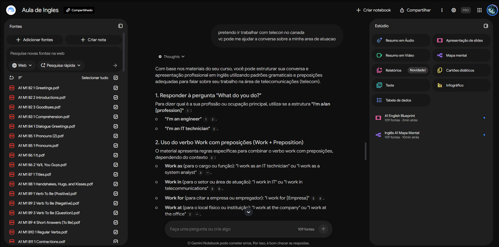
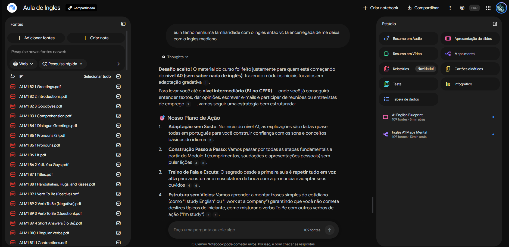
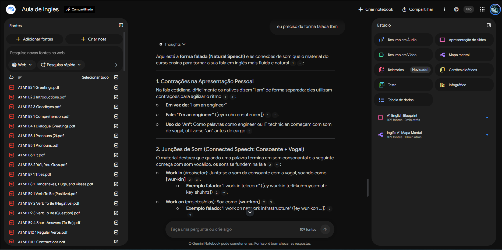

# Segundo Cérebro — Estudo de Inglês

> **Tema e Objetivo:** Este repositório documenta a criação do meu Segundo Cérebro focado em centralizar, estruturar e consultar o material do curso *Inglês Impressionador*, permitindo revisar gramática, vocabulário e pronúncia de forma ágil e fundamentada.

🔗 **Notebook:** [Abrir o Segundo Cérebro no NotebookLM](https://notebook.google.com/notebook/6fbbf904-aa37-4082-a201-08c196cd9767?authuser=1)

---

## 📚 1. Fontes Selecionadas e Relação de Confiança

O notebook foi alimentado com 108 arquivos em PDF contendo o material oficial do curso. As principais fontes incluem:

- **PDFs Oficiais de Módulos (A1 M1, M2 e M3):** Aulas temáticas cobrindo desde cumprimentos (*Greetings*), verbos regulares, pronomes, *Verb To Be*, até rotinas, membros da família e numerais.
- **Resumo do Bloco "Assista Antes de Começar":** Documento sintético com a metodologia do curso, regras do CEFR e dicas de estudo ministradas pelos professores Iury Sagaz e Nayra Brito.

### Por que confio nessas fontes?

1. **Origem Oficial:** Todo o material foi disponibilizado pela Hashtag Treinamentos, uma instituição reconhecida no ensino de idiomas e tecnologia.
2. **Estrutura Pedagógica Validada:** O conteúdo segue a régua internacional do **CEFR** (*Common European Framework of Reference for Languages*), garantindo progressão didática do nível iniciante (A1) ao avançado/fluente (B2).

---

## 🤖 2. Diretrizes de Comportamento (System Prompt)

Para garantir que o assistente responda apenas com base no conteúdo oficial das aulas e evite alucinações, foi definida a seguinte diretriz de comportamento:

```text
Você é um tutor e assistente de estudos especialista no curso Inglês Impressionador.
Sua função é responder às dúvidas do estudante utilizando estritamente as fontes
fornecidas na central de conhecimento.

Diretrizes:
1. Responda sempre fundamentado nas fontes e inclua as citações explícitas [i].
2. Se uma informação não estiver presente nos PDFs, declare claramente que o material não aborda o tema.
3. Mantenha um tom didático, encorajador e focado na comunicação prática.
```

---

## 🖼️ 3. Exemplos de Uso

Perguntas feitas ao notebook (109 fontes) e as respostas, sempre com as citações numeradas das fontes.

**Conversa sobre a área de atuação (telecom):** o assistente ensina a responder *"What do you do?"* e o uso do verbo *work* com preposições (*as*, *in*, *for*, *at*).



**Plano de estudo para quem começa do zero:** a partir do pedido de sair do nível iniciante e chegar a um inglês mediano, o assistente monta um plano de ação com adaptação gradual, treino de fala e escuta e estrutura de frases.



**Forma falada (*Natural Speech*):** contrações e junção de sons na fala, como *I'm an engineer* e *work in* soando "wur-kin".


